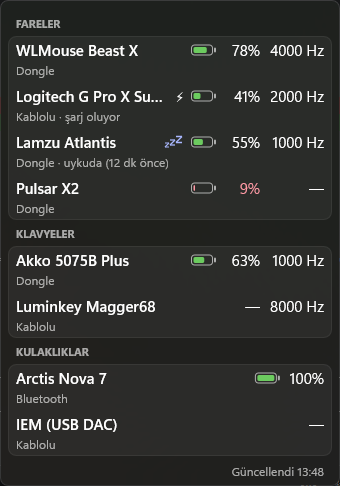

# Bilgi Paneli

[Türkçe](#türkçe) · [English](#english)



---

## Türkçe

Bilgi Paneli, Windows sistem tepsisinde duran küçük bir uygulama. İkona tıklayınca bağlı fare, klavye ve kulaklıkların **adını, pil yüzdesini, şarj durumunu ve polling rate'ini (Hz)** tek pencerede gösterir. Üretici yazılımlarını açmaya gerek kalmaz.

**İndirmek ve kullanmak için:** [bilgi-paneli-raporlar](https://github.com/Abrahamexe/bilgi-paneli-raporlar). Kurulum, kullanım ve cihaz raporu gönderme orada anlatılıyor.

### Özellikler

- Logitech, Razer, SteelSeries, Corsair, HyperX, ASUS ROG, Glorious, Pulsar, Lamzu, WLMouse, Akko/MonsGeek, NuPhy, Keychron ve daha birçok marka için protokol sürücüleri. Protokol notları: [`docs/protocols/`](docs/protocols).
- Sürücüsü olmayan kablolu cihazlarda Hz, USB tanımlayıcısından okunur. Bluetooth cihazlarda pil, Windows'tan alınır.
- Şarj oluyorsa ⚡, cihaz uykudaysa zzz işareti ve son okunan değer gösterilir.
- Cihazlara **sadece okuma** komutları gönderilir. Kodda cihaz ayarını değiştiren hiçbir komut yoktur.
- Boştayken %0 CPU, ~2 MB bellek. Arka planda polling yok; cihaz takılma olayları ve 10 dakikalık tek bir zamanlayıcı kullanılır.
- Uygulama içinden anonimleştirilmiş cihaz raporu gönderme (GitHub App, device flow).

### Derleme

Gereken: Windows 10/11 ve [Rust](https://rustup.rs) (stable, MSVC).

```
cargo build --release
```

Çıktılar:

- `target/release/bilgi-paneli.exe`: tepsi uygulaması.
- `target/release/probe.exe`: komut satırı aracı (`probe list`, `probe dump`, `probe report`).

Testler: `cargo test --release`. Sahte cihaz listesiyle arayüz denemek için: `cargo run --release --features demo`.

### Yapı

| Yol | İçerik |
|---|---|
| `src/tray.rs`, `src/panel.rs` | Tepsi ikonu ve Direct2D ile çizilen panel |
| `src/scheduler.rs` | Okuma zamanlaması ve önbellek |
| `src/devices/` | Cihaz bulma, HID, USB, Bluetooth |
| `src/devices/drivers/` | Marka ve protokol ailesi sürücüleri |
| `src/report.rs`, `src/anon.rs`, `src/github.rs`, `src/send.rs` | Cihaz raporu, anonimleştirme, gönderme |
| `docs/protocols/` | Protokol notları |

Yeni bir sürücü için `src/devices/drivers/example.rs` dosyasına bakın.

### Lisans

Lisans verilmemiştir. Kaynak kod görüntülenebilir, tüm hakları saklıdır.

---

## English

Bilgi Paneli is a small Windows system tray app. Click its icon to see the **name, battery level, charging state and polling rate (Hz)** of your connected mice, keyboards and headsets in one window, without opening each vendor's software.

**To download and use it:** see [bilgi-paneli-raporlar](https://github.com/Abrahamexe/bilgi-paneli-raporlar#english). It covers installation, usage and sending device reports. The app's interface is in Turkish, but it shows mostly numbers and icons.

### Features

- Protocol drivers for Logitech, Razer, SteelSeries, Corsair, HyperX, ASUS ROG, Glorious, Pulsar, Lamzu, WLMouse, Akko/MonsGeek, NuPhy, Keychron and many more brands. Protocol notes: [`docs/protocols/`](docs/protocols).
- For wired devices without a driver, Hz is read from the USB descriptor. For Bluetooth devices, battery comes from Windows.
- Shows ⚡ while charging, and a zzz mark with the last known values while a device sleeps.
- Sends **read-only** commands to devices. The code contains no command that changes a device setting.
- Idle: 0% CPU, ~2 MB memory. No background polling: it uses device arrival events and a single 10-minute timer.
- Built-in anonymized device report submission (GitHub App, device flow).

### Building

Requires Windows 10/11 and [Rust](https://rustup.rs) (stable, MSVC).

```
cargo build --release
```

Outputs:

- `target/release/bilgi-paneli.exe`: the tray app.
- `target/release/probe.exe`: command-line tool (`probe list`, `probe dump`, `probe report`).

Tests: `cargo test --release`. To try the UI with a fake device list: `cargo run --release --features demo`.

### Layout

| Path | Contents |
|---|---|
| `src/tray.rs`, `src/panel.rs` | Tray icon and the Direct2D panel |
| `src/scheduler.rs` | Read scheduling and cache |
| `src/devices/` | Device discovery, HID, USB, Bluetooth |
| `src/devices/drivers/` | Brand and protocol-family drivers |
| `src/report.rs`, `src/anon.rs`, `src/github.rs`, `src/send.rs` | Device report, anonymization, submission |
| `docs/protocols/` | Protocol notes |

To add a driver, start from `src/devices/drivers/example.rs`.

### License

No license is granted. The source is available to view; all rights reserved.
